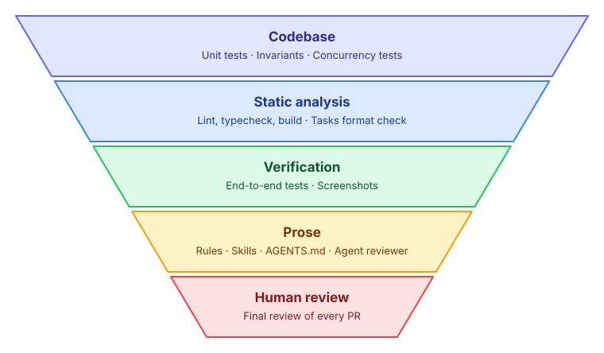

  <h1>🤖 Agentic Software Development Lifecycle</h1>
  <h3>Stop micromanaging a single agent. Climb the ladder of trust: the more you build into the environment, the more you can trust agents to do the right thing, and the more of them you can run at once.</h3>
  

    
    
    
    
    
  

---

This repo guides you step by step through setting up an agentic software lifecycle with
[OpenHands](https://github.com/OpenHands/OpenHands), [Speckit](https://github.com/github/spec-kit) and
opinionated GitHub Actions automation, with a working example you can run. It is the same workflow
used in practice to build [Discava](https://github.com/AlexTo/discava), a serverless learning
management system on AWS.

In the six days after the workflow went live on Discava on 14 November 2026, nineteen feature specs
were written this way and 132 agent pull requests were merged to implement them, each one written,
fixed and reviewed by agents. Over the same period, 209 commits landed on main. All of this with a
single maintainer, a dad with a full-time job who works on Discava casually in his spare time. 😅

## 🐌 The problem: the prompt-wait-fix loop

Using an AI assistant interactively looks fast, but the loop is slow and it needs *you* in it the
whole time:

  

Red is the developer, dashed amber is idle waiting, and every loop back runs through the person.

Each cycle is minutes of waiting and a context switch. The developer is the glue: they carry the
spec in their head, paste failures between tools and watch a spinner. The AI is quick, but the
*person* is the bottleneck, and that doesn't scale:

- One developer can only babysit one conversation at a time.
- Every engineer prompts differently, so quality and style vary with whoever drove the chat.
- Work lives in chat histories and local branches, not somewhere the team can review or resume.
- Review becomes the next bottleneck: more code is produced, but the same few people read it.
- Adding people adds coordination cost, not throughput.

## 💡 The idea

Take the developer **out of the loop** and put them at the two ends of it. Humans decide *what* to
build and *whether it's good*. Agents run everything in between, on their own, through the normal
GitHub process: specs, issues, pull requests, CI and review. Every step leaves an artifact
anyone can read, review and re-run.

  

Red is a person, grey is an agent or automation working on its own, and indigo is an automated
gate: CI, then the Reviewer agent, and after the merge the Tester agent. People are only at the two ends,
writing the spec and giving the final human review before merge, including any **(human)** tasks such as
manual verification. When a merge lands, a workflow checks that the phase's agent tasks are ticked in
`tasks.md`, then opens the next phase's issue by itself, until the spec is done.

Three agent roles do the work, each an OpenHands automation with its own prompt and model:

| Role | What it does |
| --- | --- |
| **Developer** | Implements an issue as a pull request, and revises that pull request when CI or the Reviewer sends it back |
| **Reviewer** | Reviews the pull request once its checks have finished, and approves or requests changes |
| **Tester** | Tests each merged change end to end on the deployed development stage: what the user sees, what the APIs answer, and what was actually written to storage. Then it reports what it found |

| Stage | Who | What happens |
| --- | --- | --- |
| **Spec** | Human + agent, with [Speckit](https://github.com/github/spec-kit) | A feature is written up as `spec.md`, `plan.md` and `tasks.md` under `specs/`, and reviewed as a normal PR. Speckit's `clarify` and `analyze` steps check the spec and plan before any code is written. |
| **Issues** | Automation | Merging a `spec-ready` spec PR opens the next implementation issue from `tasks.md`. |
| **Implement** | Developer agent, on [OpenHands](https://github.com/OpenHands/OpenHands), an open source platform for software engineering agents | The agent picks the issue up and opens a pull request, tests first, ticking tasks as it goes. |
| **Verify** | CI | Lint, build, unit and e2e tests run. UI changes must ship screenshots, posted on the PR. |
| **Agent review** | Reviewer agent, on OpenHands | A second agent reviews the PR once CI is green and either approves or requests changes. |
| **Fix** | Developer agent, bounded | A red CI or a "changes requested" verdict from the Reviewer agent sends the Developer agent back by itself, at most **five times** per PR, then it stops and asks for a human. |
| **Human review** | A person | A person has the final say: they review and merge. To send it back instead, they request changes and add the `openhands-review` label, so the Reviewer agent re-reviews and the review-fix loop picks it up. The person also does any **(human)** tasks the agent listed, such as manual verification. |
| **Next phase** | Automation | Merging reads `tasks.md` from the merged PR. The agent ticks each task in the PR as it finishes it. If the phase's agent tasks are all ticked, the next phase's issue opens. If not, the PR gets a comment listing the unticked tasks. **(human)** tasks never hold up the chain. When no agent tasks are left, the spec is done. |
| **Post-merge test** | Tester agent, on OpenHands (needs a deployed stage) | Once a green `main` has been deployed to the development stage, a workflow opens a test issue for each merged PR. The Tester agent clicks through the change in a real browser and calls the APIs. It doesn't stop at what it sees: it reads back what the change wrote to the database, file storage and search index (DynamoDB, S3 and OpenSearch in Discava), then reports on the issue. It closes the issue on a pass, and leaves it open with steps to reproduce on a fail. |

The "fix it" prompts you used to type by hand are now automatic, in two loops:

- **CI fix:** CI fails → status posted → agent revises the same PR. Up to five times, counted with
  `ci-fix-1` to `ci-fix-5`.
- **Review fix:** the Reviewer agent requests changes → status posted → agent revises the same PR.
  Up to five times, counted with `review-fix-1` to `review-fix-5`.

Nobody pastes an error message or relays a review comment.

### 🧑‍💼 Where people still spend time

With the loop running by itself, the main human bottleneck moves to the front: **reviewing the
spec**. Code review shrinks to one small, green, agent-approved PR per phase, but every feature
still needs someone to decide that `spec.md` says the right thing.

That review no longer has to wait for a developer. A spec is plain language: user stories,
acceptance scenarios and requirements. A business analyst or product owner can read it, comment on
the spec PR and approve it, alongside an engineer who checks `plan.md`. The people who know *what*
to build review the part that says what to build.

## 🧩 The missing glue

OpenHands and Speckit solve different problems, and neither knows about the other.

- **Speckit** turns an idea into a spec, a plan and a task list.
- **OpenHands** turns an issue into a pull request, and revises it when told something is wrong.

Between them sit the steps nobody gives you. This repo is those steps, built and tested, with a
walkthrough of how to set each one up:

| The gap | The glue here |
| --- | --- |
| Nothing turns a finished spec into work for the agent | A workflow reads `tasks.md` and opens the next implementation issue, one phase at a time |
| The agent doesn't know CI failed | A workflow reports a failing run back to the agent as a status it already watches |
| A reviewer's "changes requested" goes unheard | A workflow does the same for the Reviewer agent's verdict |
| Nothing stops a stuck agent looping forever | Both fix-up loops are capped at five tries, then a human takes over |
| `tasks.md` is only a convention, so a malformed one stalls the pipeline silently | A PR check validates its format |
| UI changes reach review without anyone seeing them | A check requires e2e screenshots, posted on the PR |
| Merging the agent's PR doesn't start the next phase | The merge opens the next issue until the spec is done |
| The agent can't run the real stack without cloud access | Local emulators for every service (database, queue, storage, search, login), so it runs the e2e tests before opening a PR, with no credentials |
| Merging doesn't ship anything | A green build on `main` deploys by itself, skips a commit that is no longer the latest, and production waits for a human approval |
| An agent can commit a leaked secret or a vulnerable dependency | A security scan runs on every build, and again before each deploy |
| Nobody checks the merged change where it actually runs | Each deploy opens a test issue per merged PR, and the Tester agent tests it on the deployed stage (in Discava; the example app here has no deploy) |

Wire these together and you get the end-to-end loop above.

## 🚀 Why this scales a team

- ⚡ **Parallel, not serial.** Developers no longer babysit a conversation each. Specs split into
  phases, phases run as a chain of small PRs, and several features can be in flight at once while
  people do other work.
- 📜 **The spec is the source of truth, not a prompt.** It says what to build and why, is reviewed like
  code, and every agent run reads the same thing, so quality doesn't depend on who phrased the prompt.
  The plan, tasks and code all derive from it: to change behaviour, change the spec and regenerate
  instead of patching the code by hand.
- 🔍 **Review stays small and focused.** One phase per PR, a scoped task range, screenshots instead of
  "pull the branch and run it". Reviewers judge outcomes instead of hunting for them.
- 🧠 **Nothing lives in someone's head.** Intent is in the spec, scope is in the issue, history is in
  the PR. A new teammate or a new agent can pick up where the last one stopped.
- ✅ **Trust is built into the environment.** Rules, tests and checks are layered
  ([below](#️-automation-you-can-trust)), so mistakes surface and go back to the agent without a
  person reading every line. Time spent on that environment pays off on every change after it.
- 🛡️ **Humans stay in control where it matters.** Agents can't merge, can't edit workflows, can't touch
  credentials, and can't weaken a test to make it pass. Retries are capped, so a stuck agent
  escalates instead of looping.
- 🎯 **Senior time goes to judgment.** Writing a good spec, building the environment agents are checked
  by, and reviewing a PR are the high-leverage jobs. The typing and the waiting in between are delegated.

## 🛡️ Automation you can trust

Automation is only worth it if you can trust what comes out. Every change passes through layers of
checks, and each layer narrows what reaches the next: cheap, automatic checks run first and catch the
most, and only what they can't judge reaches a person. When a check fails, the failure goes straight
back to the agent to fix, with no human in between.

  

| Level | Layer | What it catches |
| --- | --- | --- |
| **Codebase** | Unit tests | Wrong business logic and broken rules |
| | Invariants | Data that breaks a rule spanning records, checked after every e2e test |
| | Concurrency tests | Race conditions when requests hit at the same moment |
| **Static analysis** | Lint, typecheck, build | Style, type and build errors |
| | Tasks format check | A malformed `tasks.md` that would silently stall the pipeline |
| | Generated files check | Lint or build output the agent forgot to commit |
| **Verification** | End-to-end tests | Broken user flows, run in a real browser against the local stack |
| | Screenshots | UI changes nobody has looked at, required on the PR |
| | Post-merge test | A change that passed every check and still fails on the deployed stack, found by the Tester agent after the merge |
| **Prose** | Rules, skills, `AGENTS.md` | Guidance the agent reads before it writes code, so conventions are followed instead of caught later |
| | Reviewer agent | Problems the tests don't cover, read like a code review |
| **Human review** | Final review | Whatever the layers above can't judge; a person always merges |

A red result sends the agent back to fix the same PR, up to **5 times**. After that it stops and
asks a human. Of all the layers, verification matters most: see
[why](https://alexto.github.io/agentic-sdlc/en/concepts/layers-of-trust/#verification-matters-most).

## 🧰 What's in this repo

This is a small, working notes app (DynamoDB, tRPC API, React website, Playwright e2e) wrapped in
the complete pipeline, so you can see the workflow end to end rather than read about it.

| Piece | Where |
| --- | --- |
| Spec tooling (Speckit) | `.specify/`, `.claude/skills/speckit-*`, `specs/` |
| Spec → issue automation | `.github/workflows/agent-issues.yml` |
| Finished spec → archive PR | `.github/workflows/archive-specs.yml` |
| Issue template handed to OpenHands | `.github/ISSUE_TEMPLATE/implement-phase.md` |
| CI and PR checks (lint, test, e2e, screenshots) | `.github/workflows/ci.yml`, `pr-checks.yml`, `ui-screenshots.yml` |
| Bounded fix-up loops | `.github/workflows/agent-ci.yml`, `agent-review.yml` |
| The rules behind the automation (unit-tested) | `packages/common/scripts/src/agent-*` |
| Example app | `packages/notes-*`, `packages/e2e` |

## 📚 Learn more

Read the full guide at **[alexto.github.io/agentic-sdlc](https://alexto.github.io/agentic-sdlc/)**:
the concepts behind the workflow, how Discava fills each gap (with a real feature traced from spec
to merge), how to fork this repository and run the same workflow yourself, how to adopt it in
your own repository, a tutorial, and reference pages.
Its source is in [`docs/`](docs).
